<div align="center">



<br/>

<a href="https://madhankumart.in"></a> <a href="https://linkedin.com/in/madhankumart"></a> <a href="mailto:madhankumartbharathuniv@gmail.com"></a> <a href="https://github.com/Madhan310301"></a>

<br/><br/>


</div>

<br/>


## About

I'm a third-year Computer Science Engineering student at BIHER, Chennai, building intelligent systems where machine learning, computer vision, IoT and full-stack product work meet. I approach every build like a product engineer, from cross-modal satellite retrieval to IoT safety hardware shipped in 24 hours, and I care more about systems that are reliable, measurable and shippable than ones that only look good in a demo.

| | |
|---|---|
| **Now building** | **SatBridge**, a cross-modal SAR/optical satellite retrieval system for ISRO's Bharatiya Antariksh Hackathon 2026 |
| **Shipped fast** | **SafePathAI**, an IoT child-safety wearable built end to end in 24 hours: Overall 2nd Prize and Domain 1st Prize at Genesis Hackathon 2026 |
| **Full stack** | React, Next.js, Node.js, FastAPI, Supabase |
| **Deep focus** | Deep learning and retrieval systems: DualEncoder architectures, FAISS, contrastive / InfoNCE loss |
| **Community** | Google Student Ambassador (GID 3150), HCLTech Campus Ambassador, Event Coordinator for BIHER CSE |
| **Principle** | Honest metrics over inflated demos. I ship what's real, not what looks good on a slide |
| **Open to** | Internships, freelancing, paid projects, startup roles |


## Tech Stack

| | |
|---|---|
| **Languages** |         |
| **Frontend** |        |
| **Backend & Data** |           |
| **AI / ML** |      |
| **IoT & Embedded** |     |
| **Cloud & Tooling** |          |


## AI / ML Expertise

<div align="center">

| Domain | Level | Details |
|---|:---:|---|
| **Computer Vision** | ▰▰▰▰▰ | CNNs, transfer learning (ResNet18, MobileNetV2), cross-modal retrieval, YOLOv8, OpenCV pipelines |
| **Deep Learning** | ▰▰▰▰▰ | DualEncoder architectures, contrastive learning (InfoNCE), embedding spaces, PyTorch / TensorFlow |
| **Retrieval Systems** | ▰▰▰▰▰ | FAISS similarity search, shared embedding spaces, multi-sensor remote sensing retrieval |
| **NLP & LLM Systems** | ▰▰▰▰▱ | RAG pipelines, LangChain agent orchestration, prompt engineering, LLM-powered applications |
| **Classical ML** | ▰▰▰▰▱ | Scikit-learn, XGBoost, regression / classification, time-series forecasting |
| **IoT & Embedded AI** | ▰▰▰▰▱ | Sensor fusion (GPS / GSM / IMU), on-device logic, real-time alerting on ESP32-class hardware |
| **MLOps & Deployment** | ▰▰▰▰▱ | FastAPI / Flask model serving, Docker containerization, GPU-accelerated training on Colab |

</div>


## Featured Projects

| Project | What it does | Stack | Outcome |
|---|---|---|---|
| **SatBridge** | Cross-modal SAR / optical satellite image retrieval. A ResNet18 DualEncoder with InfoNCE loss projects both modalities into a shared 256-dim space for FAISS nearest-neighbour search | PyTorch, ResNet18, FAISS, FastAPI, Uvicorn, Next.js | Trained on ~75,724 image pairs (Spring SEN1-2). ISRO Bharatiya Antariksh Hackathon 2026 entry. *Private team repo* |
| **SafePathAI** | IoT child-safety wearable: GPS tracking, fall / motion detection and GSM emergency SMS that works without data connectivity. Parent-only RBAC dashboard and a Blender-rendered pitch | ESP32C3, NEO-6M, MPU6050, SIM800L, React, TypeScript, Supabase, Blender | Genesis Hackathon 2026: **Overall 2nd Prize** and **Domain-Wise 1st Prize**. [Profile](https://github.com/Madhan310301) |
| **RM Online App** | Pharmacy catalog, ordering and order tracking for a real client, Raghavendra Medicals | React / Next.js, Node.js, Express, MongoDB, payment gateway | Real client delivery, actively used by the business |
| **HealAI** | Decentralized cloud-edge framework for real-time IoT health monitoring with predictive alerts | React, Node.js, Express, MongoDB, Python | ~25% lower API latency vs. a cloud-only baseline |

<details>
<summary><b>More projects</b> (click to expand)</summary>
<br/>

| Project | What it does | Stack | Result |
|---|---|---|---|
| **AgriGrade** | CNN pipeline that grades tender coconuts and turmeric by visual quality markers | TensorFlow / Keras, OpenCV, Flask | ~90% grade-prediction accuracy |
| **PredMaintain** | Machine health scoring from sensor data, flagging anomalies before failure | Scikit-learn, XGBoost, TensorFlow (LSTM), pandas | ~20% less simulated downtime vs. reactive baseline |
| **CivicPulse** | Hyperlocal civic issue reporting. Gemini 1.5 Flash classifies and prioritizes photo + location reports for routing. [Profile](https://github.com/Madhan310301) | Next.js 14, Gemini 1.5 Flash, Firebase, Cloud Run | Solo build in ~1 week for Vibe2Ship (CodingNinjas) |
| **SarvaJeevaID** | Concept platform giving every citizen a lifelong ID unifying health, education, employment and welfare records, with offline-first QR access | React 18, TypeScript, Node.js, Express, PostgreSQL, Redis, Supabase, AWS S3 | Technical blueprint |
| **DocuAI** | AI document reader with OCR and RAG-based Q&A over PDFs | Python, PyMuPDF, LangChain, GPT-4, FastAPI | n/a |
| **NexusAI** | Personal AI assistant with voice, scheduling and task automation | Python, LangChain, GPT-4, Whisper, FastAPI | n/a |
| **NutriLensAI** | Photo-based calorie and macro estimator | PyTorch, CNN, Nutrition API, FastAPI | n/a |
| **NeuroDot** | Camera-based Braille language detector, no external API | Python, OpenCV, custom CNN, pyttsx3 | n/a |
| **FinTech** | AI financial coach that grades financial health and recommends savings / investment moves | Scikit-learn, XGBoost, NLP transformers, Flask | n/a |
| **MemoAI** | AI diary companion that expands short notes and voice snippets into journal entries in your own tone | GPT-based LLM, Whisper, Flask, Next.js | n/a |
| **HabiAI** | Habit tracker with streak analytics and adaptive reminders | React Native, Node.js, MongoDB, Scikit-learn, FCM | n/a |
| **RenoAI** | Conversational agent for home renovation: cost estimates, materials, mood boards | Next.js, LangChain, GPT-4, Firebase | n/a |
| **DrakoZu** | Custom printed T-shirt store with a live design canvas and fulfillment dashboard | React, Node.js, Express, MongoDB, Cloudinary, Razorpay | n/a |
| **People Watcher** | Crowd density estimation and anomaly detection for public-safety monitoring | OpenCV, YOLOv8, DeepSORT, Flask | n/a |
| **AMH Hostel App** | Hostel bed booking with online fee payment and an admin occupancy panel | React, Node.js, Express, MySQL, Razorpay, JWT | n/a |

</details>


## Experience & Leadership

**Lead Builder & Presenter, Genesis Hackathon 2026** · SRMEEC, Chennai · 2026
Designed, built and pitched SafePathAI inside a 24-hour window, from hardware bring-up to a Shark-Tank-style investor pitch.
- Built the GPS + fall-detection + GSM emergency-alert pipeline on ESP32C3
- Shipped a parent-only RBAC web dashboard alongside the hardware
- Produced a Blender 3D product animation for the pitch
- Won **Overall 2nd Prize** and **Domain-Wise 1st Prize**

**ML Engineer & Backend Developer, Team SatBridge** · ISRO Bharatiya Antariksh Hackathon 2026 · 2026 to present
Leading ML and backend architecture for cross-modal satellite image retrieval, from dataset engineering to API deployment.
- Architected a DualEncoder contrastive-learning pipeline for SAR-optical retrieval
- Diagnosed and fixed data-pipeline bugs that affected training integrity
- Built a FastAPI + Uvicorn backend serving FAISS similarity search
- Reported honest, unembellished metrics over inflated demo numbers

**Event Coordinator** · BIHER, Chennai · 2024 to present
- Planned and ran technical workshops and inter-batch events across the CSE cohort
- Handled logistics, communication and participation drives; maintained attendance and documentation for the CSE batch (U24CS)

**Google Student Ambassador** · Google Developer Program, GID 3150 · 2025 to present
- Organized campus technical events and community programs
- Built automated certificate-generation pipelines for event participants

**Campus Ambassador** · HCLTech · 2025 to present
- Bridged HCLTech's campus initiatives with student technical communities and supported outreach programs at BIHER


## Achievements

<div align="center">

| Recognition | Details |
|---|---|
| **Overall 2nd Prize** | Genesis Hackathon 2026, SafePathAI (built in 24 hours) |
| **Domain-Wise 1st Prize** | Genesis Hackathon 2026, SafePathAI |
| **ISRO BAH 2026 Entry** | Team SatBridge, cross-modal satellite retrieval |
| **Google Student Ambassador** | GID 3150 |
| **HCLTech Campus Ambassador** | Active program member |
| **CGPA 9.5 / 10** | B.Tech CSE, BIHER Chennai (2024 to 2028) |
| **~90% model accuracy** | CNN grading pipeline, AgriGrade |
| **~25% API latency reduction** | Cloud-edge healthcare framework, HealAI |
| **Real client delivery** | RM Online App, live for Raghavendra Medicals |
| **28+ end-to-end projects** | AI/ML, IoT, full-stack and product engineering |

</div>


## Education & Certifications

<div align="center">

| Degree | Institution | Year | Score |
|---|---|---|---|
| **B.Tech, Computer Science Engineering** | Bharath Institute of Higher Education and Research (BIHER), Chennai | 2024 to 2028 (expected) | **CGPA 9.5 / 10** |
| Higher Secondary Certificate (HSC) | Dawn Shikshalaya Public School | 2024 | **91.80%** |
| Secondary School Leaving Certificate (SSLC) | Dawn Shikshalaya Public School | 2022 | **86.80%** |

<br/>


</div>


## Coding Profiles

<div align="center">

<a href="https://leetcode.com/madhankumartbharathuniv"></a> <a href="https://www.geeksforgeeks.org/profile/madhankumart"></a> <a href="https://www.hackerrank.com/profile/madhankumartbha1"></a> <a href="https://www.codechef.com/users/madhankumart"></a> <a href="https://hack2skill.com/"></a>

</div>


## GitHub Activity

<div align="center">


<br/><br/>


<br/><br/>


<br/>


<br/>


<br/><br/>


</div>


## Current Focus

```yaml
Learning:
  - Advanced Contrastive Representation Learning
  - System Design at Scale (distributed systems, CAP theorem)
  - Data Structures & Algorithms (LeetCode intensive)
  - Agent Memory Infrastructure & RAG architectures

Building:
  - SatBridge: Cross-Modal Satellite Retrieval (ISRO BAH 2026)
  - Personal Portfolio v2: Next.js + React Three Fiber

Exploring:
  - TinyML / Edge AI (ESP32-class on-device inference)
  - LLM Evaluation Frameworks & hallucination detection
  - RBAC & Auth Architecture (Supabase RLS, JWT flows)

Open To:
  - Internship Opportunities
  - Freelancing
  - Paid Projects
  - Startup Job Opportunities
```


## Connect

<div align="center">

<a href="https://madhankumart.in"></a> <a href="https://linkedin.com/in/madhankumart"></a> <a href="mailto:madhankumartbharathuniv@gmail.com"></a> <a href="https://github.com/Madhan310301"></a>

<br/><br/>

*"Build systems that are honest about what they can do, not systems that just look good in a demo."*



</div>
